<div align="center">

# bot-message-analyzer

**Console tool that finds the questions a chatbot or voicebot cannot answer.**

A **C# / .NET 8** command-line tool that reads conversation logs, judges every customer turn with fixed rules and the Gemini API, groups the failures by topic and writes a ranked list of gaps with phrases to use as retraining input.

<br />


[](https://github.com/tworekrobert/bot-message-analyzer/actions/workflows/ci.yml)

<br />

<a href="#features">Features</a> |
<a href="#installation-and-run">Run</a> |
<a href="#usage">Usage</a> |
<a href="#sample-run-result">Sample result</a> |
<a href="#configuration">Configuration</a> |
<a href="#input-format">Input</a> |
<a href="#how-classification-works">How it works</a> |
<a href="#limitations-and-privacy">Privacy</a> |
<a href="#development">Development</a> |
<a href="#licence">Licence</a>

</div>

---

## Overview

<table>
  <tr>
    <td><strong>Problem</strong><br />A bot that cannot answer usually says so in a fixed fallback sentence, and a bot that answers the wrong question looks fine in a transcript. Finding the topics customers keep asking about without success means reading thousands of conversations.</td>
    <td><strong>What it does</strong><br />Reads one JSON log file, judges each customer turn as answered, not understood or wrong answer, groups the failures by topic and ranks them.</td>
    <td><strong>Output</strong><br /><code>report.md</code> for reading, <code>gaps.csv</code> for the ranked list and <code>training-candidates.csv</code> with the customer messages the bot did not understand.</td>
    <td><strong>Scope</strong><br />Independent of any bot platform. Input is one documented JSON format, and the only external service is the Gemini API.</td>
  </tr>
</table>

---

## Features

| Area | Implemented scope |
| --- | --- |
| Input | JSON conversation logs, validated up front; every problem is reported with its conversation id (`bma validate`) |
| Turns | Customer messages merged into turns, each paired with the bot reply that followed; trailing customer message kept without a reply |
| Verdicts | `Answered`, `NotUnderstood`, `WrongAnswer`, each with a topic label and a one-sentence reason |
| Fallback rules | Phrases from the config override the model verdict, so the bot's own "I did not understand" is never judged by the model |
| Topics | Near-duplicate labels merged in one extra model call; if it fails, labels are only lowercased and trimmed and the report says so |
| Redaction | Emails, phone numbers and long digit sequences replaced before anything is cached or sent |
| Cache | Every model answer stored in a JSON Lines file; unchanged input makes no API calls |
| Failure handling | Retries on HTTP 429, 503 and network errors with back-off; rejected requests stop the run early; turns the model could not judge are `Unclassified` with a warning |
| Exit codes | `0` ok, `1` unexpected error, `2` invalid input or config, `3` more than 10% `Unclassified` |
| Reports | Markdown report, ranked CSV, training-candidates CSV (UTF-8, RFC 4180, CRLF) |

---

## Requirements

- .NET 8 SDK
- A Gemini API key, only for turns that are not already in the cache

---

## Installation and run

```bash
git clone https://github.com/tworekrobert/bot-message-analyzer.git
cd bot-message-analyzer
dotnet build -c Release
```

Reproduce the sample report from the committed cache. No key is needed and no request is sent:

```bash
dotnet run --project src/BotMessageAnalyzer -c Release -- analyze samples/clinic-conversations.json --config samples/config.json --cache samples/clinic.cache.jsonl --out out
```

Analyze your own file:

```bash
export GEMINI_API_KEY=your-key-here        # PowerShell: $env:GEMINI_API_KEY = "your-key-here"
dotnet run --project src/BotMessageAnalyzer -c Release -- analyze my-logs.json --config samples/config.json --out out
```

Check an input file without calling the API:

```bash
dotnet run --project src/BotMessageAnalyzer -c Release -- validate my-logs.json
```

`.env.example` shows the variable name. The key is read from the environment only, and `.env` is ignored by git.

---

## Usage

```text
bma analyze <input.json> --config <config.json> [--out ./out] [--cache .cache/responses.jsonl]
bma validate <input.json>
```

`--config` is required because the model name comes from it. If a turn is not in the cache and `GEMINI_API_KEY` is not set, the run stops with exit code `2` before sending anything.

Excerpt of `out/report.md` from the sample run:

```text
| Verdict | Turns | Share of all turns |
|---|---|---|
| Answered | 149 | 70.6% |
| NotUnderstood | 52 | 24.6% |
| WrongAnswer | 10 | 4.7% |
| Unclassified | 0 | 0.0% |

| Rank | Topic | Turns | Share of failed turns | Not understood | Wrong answer | Suggested action |
|---|---|---|---|---|---|---|
| 1 | lab results collection | 9 | 14.5% | 9 | 0 | Add an intent and training phrases |
| 2 | appointment cancellation | 7 | 11.3% | 2 | 5 | Review the bot's answer |
| 3 | vaccination certificate copy | 7 | 11.3% | 7 | 0 | Add an intent and training phrases |
| 4 | prescription renewal | 6 | 9.7% | 6 | 0 | Add an intent and training phrases |
| 5 | holiday opening hours | 5 | 8.1% | 1 | 4 | Review the bot's answer |
```

Each gap in the report lists up to three example customer messages with the bot reply and the conversation ids. `gaps.csv` holds the full ranking, and `training-candidates.csv` lists one row per not-understood customer message, grouped by topic.

---

## Sample run result

| | |
| --- | --- |
| Date | 2026-11-09 |
| Model | `gemini-3.5-flash-lite` |
| Input | `samples/clinic-conversations.json`: 66 synthetic conversations, 211 customer turns |
| Result | 62 failed turns in 24 topics, 0 `Unclassified` |
| Requests | 16 (15 classification batches and one topic merge) |

The sample contains five planted gaps and two planted wrong-answer patterns. What the tool found:

- Lab results, vaccination certificates and prescription renewals each came out as one topic (ranks 1, 3 and 4).
- Parking and step-free access were split: parking information (rank 6), car parking cost, wheelchair accessibility and bicycle parking are separate topics.
- Invoices and insurance were split: billing invoice request (rank 7) and insurance coverage check (rank 8), plus three single-turn insurance labels.
- Both wrong-answer patterns were detected: cancellation answered with the booking flow (5 wrong answers) and holiday hours answered with the regular hours (4 wrong answers).

Model output can differ between runs, models and prompt versions. The committed cache (`samples/clinic.cache.jsonl`) is what makes this result reproducible.

---

## Configuration

`samples/config.json`:

```json
{
  "model": "gemini-3.5-flash-lite",
  "batchSize": 15,
  "requestDelayMs": 6500,
  "maxRetries": 4,
  "fallbackPhrases": ["did not understand", "can you rephrase", "i can only help with"]
}
```

| Field | Meaning | Default |
| --- | --- | --- |
| `model` | Gemini model name. Required. | none |
| `batchSize` | Turns per request, 1 to 50. | 15 |
| `requestDelayMs` | Pause before every request after the first, in milliseconds. Raise it if you hit rate limits. | 4500 |
| `maxRetries` | Retries on HTTP 429, 503 and network errors, 0 to 10. Waits 1, 2, 4, 8 s, or the `Retry-After` value when the API sends one. | 4 |
| `fallbackPhrases` | Case-insensitive phrases your bot uses when it does not understand. A bot reply containing one is always `NotUnderstood`. | the three above |

Use the phrases your own bot actually says, otherwise the rule pass has nothing to match and every verdict comes from the model.

---

## Input format

```json
{
  "conversations": [
    {
      "id": "c-001",
      "channel": "chat",
      "messages": [
        { "role": "bot", "text": "Hello, how can I help?" },
        { "role": "customer", "text": "Do you issue immunisation records?" },
        { "role": "bot", "text": "Sorry, I did not understand that." }
      ]
    }
  ]
}
```

| Rule | Detail |
| --- | --- |
| `id` | Required, unique. `channel` is optional. |
| `role` | `customer` or `bot`. `text` must not be empty. |
| Conversation | Needs at least one customer message. |
| Turns | Consecutive customer messages are merged. A greeting before the first customer message is ignored. Each turn is cut to 1000 characters. |

---

## How classification works

```mermaid
flowchart LR
    Log["Conversation log (JSON)"] --> Load["Load and validate"]
    Load --> Redact["Redact emails, phones, numbers"]
    Redact --> Turns["Build turns"]
    Turns --> Cache{"In cache?"}
    Cache -- yes --> Verdicts
    Cache -- no --> Model["Gemini, batches of turns"]
    Model --> Store["Write to cache"]
    Store --> Verdicts["Verdicts and topics"]
    Verdicts --> Rules["Fallback phrase rules override"]
    Rules --> Merge["Merge similar topics (one call)"]
    Merge --> Out["report.md, gaps.csv, training-candidates.csv"]
```



1. Each conversation is split into turns and redacted.
2. Uncached turns go to the model in batches with a fixed prompt (`prompts/classify.v1.md`), temperature 0 and a JSON schema for the answer. The answer is parsed strictly: invalid JSON, or an id the model skipped, leaves those turns `Unclassified`.
3. The fallback phrase rules are applied on top of the model verdict.
4. The distinct topic labels of failed turns go to one more call (`prompts/merge-topics.v1.md`) that merges near-duplicates.
5. Failed turns are grouped by topic and ranked by count.

The cache key is a hash of the prompt text, the model name and the redacted turn. Changing a prompt or the model therefore triggers fresh calls, and failed batches are never cached.

---

## Limitations and privacy

- Conversation text is sent to the Gemini API. Do not use real logs with sensitive content unless you are allowed to share them with a third-party API, and check the data-use terms of your API plan first.
- Redaction is regex based. It replaces emails with `[email]`, phone numbers with `[phone]` and other digit sequences of seven or more with `[number]`. It does not remove names or other free-text details.
- Topic labels come from a language model. Related problems are sometimes split across several labels, and results vary between models and prompt versions.
- Each turn is judged on its own, with only the one bot reply that followed it. Context from earlier in a long conversation is not used.
- The `generateContent` endpoint used here is marked as legacy in Google's documentation. Model availability for new API users changes: if a model is rejected, the run stops and prints the message from the API.
- The sample conversations are synthetic. The clinic, its staff and every email and phone number in them are made up.

---

## Development

```bash
dotnet test
```

The tests use fake classifiers and stubbed HTTP responses, so they need no key and no network. The report has a golden-file test (`tests/BotMessageAnalyzer.Tests/Golden/report.expected.md`). The same build and test commands run in GitHub Actions on every push and pull request.

### Project structure

```text
bot-message-analyzer/
|-- src/BotMessageAnalyzer/
|   |-- Input/            # loader, validation, redaction, turn building
|   |-- Classification/   # Gemini client, classifier, cache, fallback rules, config
|   |-- Reporting/        # gap ranking, Markdown report, CSV writers
|   |-- AnalyzeCommand.cs
|   |-- Program.cs
|-- tests/BotMessageAnalyzer.Tests/
|-- prompts/              # versioned prompts, embedded in the build
|-- samples/              # synthetic conversations, config, committed cache
|-- .github/workflows/ci.yml
|-- .env.example
|-- BotMessageAnalyzer.sln
```

---

## Engineering decisions

| Decision | Reason |
| --- | --- |
| Single `IClassifier` interface | The pipeline and the tests do not depend on Gemini; a fake classifier drives every test. |
| Plain `HttpClient`, no SDK | One request shape to maintain and no extra dependency. |
| Cache keyed on prompt, model and redacted turn | Reruns are free and reproducible, and editing a prompt cannot return stale answers. |
| Fallback rules override the model | The bot's own fallback sentence is a fact, not something to be judged. |
| Strict parsing of model output | A malformed answer becomes `Unclassified` with a warning instead of a guess. |
| Prompts in versioned files | The prompt version is printed in the report, so a result can be tied to the wording that produced it. |
| Rejected requests stop the run | A wrong model name or key is reported once instead of failing 15 times. |

### Deliberate project boundaries

- Only the Gemini API is supported as a model backend.
- Only the JSON input format described above is read; there is no importer for any bot platform.
- No names are removed from the text; see Limitations and privacy.
- The sample data is synthetic, and the tool is meant for logs you are allowed to share with the API.

---

## Troubleshooting

### `error: No config given`

`--config` is required. Pass `--config samples/config.json`.

### `N of M turns are not in the cache and GEMINI_API_KEY is not set`

Some turns have no cached answer. Set `GEMINI_API_KEY`, or use the cache that matches your input, model and prompts. Changing the model or a prompt invalidates the cache.

### `HTTP 404: ... no longer available to new users`

The model in your config is not offered to your account. Pick another model from Google's current list and set it in the config.

### `HTTP 503: ... high demand`

The model is overloaded. The tool retries with back-off up to `maxRetries` times; after that the affected turns are `Unclassified`. Rerun later, and only those turns are sent again.

### `HTTP 429`

You hit the rate limit. Increase `requestDelayMs` or lower `batchSize`.

### Exit code `3`

More than 10% of turns are `Unclassified`. Read the console output for the API message, fix the cause and rerun; answered turns come from the cache.

### PowerShell shows `NativeCommandError` for the warning lines

PowerShell wraps messages written to the error stream. The run itself is unaffected.

---

## Licence

MIT. See [LICENSE](LICENSE).
